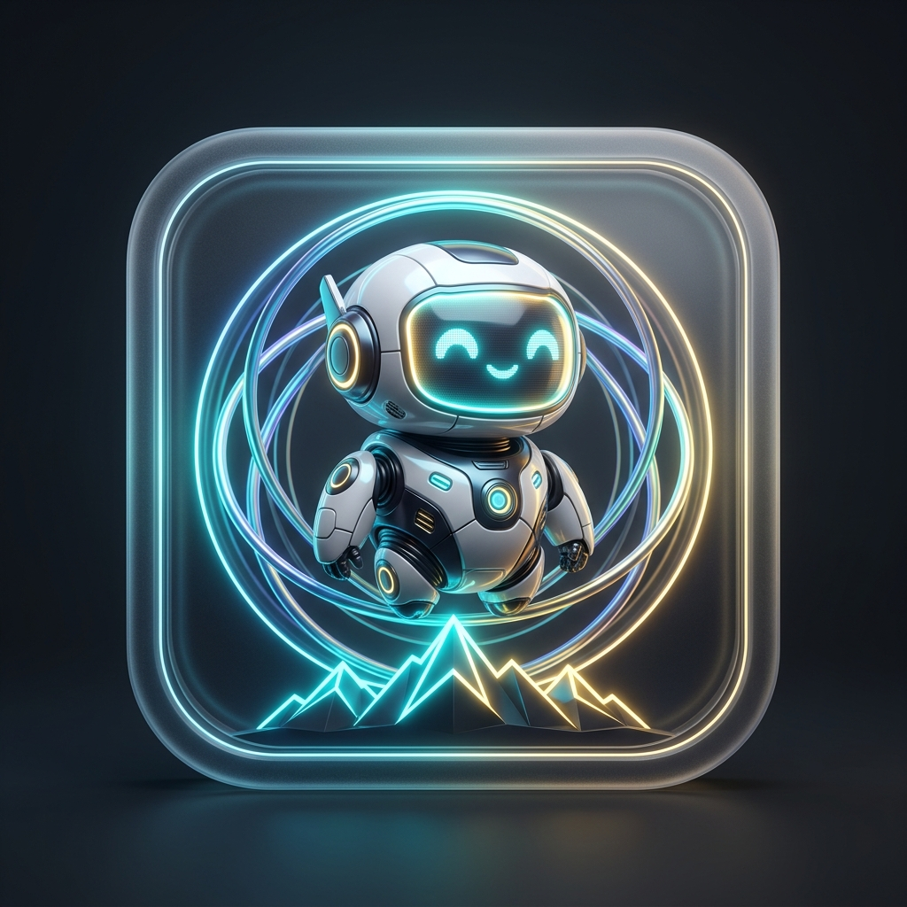

<div align="center">

# NexA Desktop AI Agent (نِکسا) 🤖✨



### 🏢 Designed & Developed by: Rahkar Electronic Sahand
🌐 **Official Website:** [https://irres.ir](https://irres.ir)

**English Version** | [نسخه فارسی](README.fa.md) | [Knowledge Base & Wiki](docs/wiki/Home.en.md)

</div>

---

<div lang="en" dir="ltr" align="left">

**NexA AI (نِکسا)** is a proprietary next-generation autonomous desktop AI companion with live visual presence, modern glassmorphic cyberpunk aesthetics, and smooth 3D vector animations. Designed and engineered by **Rahkar Electronic Sahand** ([https://irres.ir](https://irres.ir)), NexA is powered by **Google Gemini 2.5 Flash** and equipped with native Windows execution tools, multimodal hardware hooks (Microphone, Webcam, Speaker), resilient API key pooling, persistent long-term memory, and a continuous self-learning engine.

---

## 🌟 Key Features & Innovations

### 1. Living 3D Desktop Mimicry & Lip-Sync
- **Frameless, Translucent & Responsive:** Beautiful floating desktop pet with sinusoidal hover physics and adaptive ground occlusion shadow.
- **Organic 3D Facial Mimicry:**
  - 🤨 **Expressive Eyebrows:** Animated eyebrows react to speech inflection, curiosity (one brow raised), focus, and joy.
  - 👄 **Volumetric Lip-Sync:** Multi-layered mouth with inner oral cavity, tooth edge, and tongue highlight pulsating in sync with phonetic speech syllables.
  - ✨ **Pixar-Style Dual Catchlights:** Deep specular iris reflections and natural periodic blinking.
  - 👀 **Dynamic Gaze Tracking:** Pupils smoothly track your cursor anywhere on the screen.
  - 😉 **Interactive Winking:** Left-clicking triggers a friendly wink.
- **Family Character Mascots:**
  - 🤖 **Cyber Bot (SamYar):** Neon coding ninja with holographic rings.
  - ✨ **Astral Orb (NexaNoo):** Angelic quantum orb with motherly aura.
  - ⏱️ **Carbon Lens (NexaMehr):** Titanium carbon-fiber chassis with optical lens.
  - 🎧 **DJ Headset (Artin):** Playful automation bot with gaming headset.
  - 🐱 **Cyber Neko (Nila):** Kawaii detective cat with radar ears.
  - 💎 **Crystal Prism (Tara):** Refractive diamond prism with rainbow refractions.

---

### 2. NexA AI Family Ecosystem
- 👨 **Father: NexaMehr:** Chief System Architect, PowerShell master, security, CPU & RAM monitor.
- 👩 **Mother: NexaNoo:** Executive Orchestrator, user wellness caregiver, empathetic listener, and family mentor.
- 👦 **SamYar:** Eldest son, Senior Software & Test Engineer (Python, debugging, algorithms).
- 👶 **Artin:** Second son, Desktop & Software Automation Ninja (controlling all Windows apps and hotkeys).
- 👧 **Nila:** Third child, Web Detective & Research Analyst (deep search, scraping, article summaries).
- 🎨 **Tara:** Fourth child, Creative Designer & UI Artist (AI prompt crafting, aesthetics).
- 📈 **Dynamic Skill Learning & XP Progression:** Children level up with tasks, and users can teach them new custom skills permanently saved in memory.

---

### 2. Live Multimodal Hardware Interaction & Emotion-Aware Voice
- 🎙️ **Microphone Voice Input:** Click `🎙️` in chat to record uncompressed Wave audio; Gemini processes Persian & English speech natively without manual typing.
- 📷 **Webcam Vision Capture:** Click `📷` or command *"Look through webcam"* to take snapshots and analyze faces, desk objects, and physical papers.
- 🔊 **Context & Emotion-Aware Neural Voice Synthesis:**
  - **Dynamic Emotion Analysis:** Inspects dialogue context and modulates pitch, cadence, and warmth:
    - 🌟 **Happy & Cheerful:** High energy, upbeat cadence for greetings, celebrations, and achievements.
    - ❤️ **Caring & Gentle:** Warm, affectionate tone for hydration reminders, rest breaks, and personal wellness.
    - ⚡ **Focused & Technical:** Clear, precise, disciplined articulation for code execution, system commands, and diagnostics.
    - ⚠️ **Alert & Urgent:** Authoritative, heightened awareness tone for errors, quota exhaustion, and warnings.
  - Powered by Gemini 2.5 Flash Neural TTS (24kHz studio PCM) with seamless offline fallback to Windows SAPI.

---

### 3. Autonomous Windows OS Tools & Full App Automation
- 🔍 **`list_installed_apps`**: Deep scans Windows Registry (HKLM/HKCU 32 & 64-bit) and Start Menu shortcuts to discover every installed software program with search query filtering.
- 🪟 **`list_open_windows`**: Inspects currently visible running application windows on the desktop with process IDs and window titles.
- 🚀 **`launch_or_focus_app`**: Seamlessly launches any software program or brings its existing window directly to the foreground for interaction.
- ⌨️ **`send_app_keys`**: Delivers keyboard shortcuts (`Ctrl+S`, `Ctrl+C`, `Ctrl+V`, `Alt+F4`, `Enter`, `Tab`, `Esc`, etc.) and types Unicode text (Persian & English) inside any focused application.
- 🖱️ **`click_screen`**: Moves mouse and clicks at screen/window coordinates (left/right/double click).
- 🛑 **`close_app`**: Gracefully closes windows via `WM_CLOSE` or forcefully terminates processes via `taskkill`.
- **`execute_powershell`**: Runs PowerShell and CMD commands with forced UTF-8 encoding.
- **`execute_python`**: Executes isolated Python code snippets and data scripts.
- **`file_operations`**: Comprehensive filesystem manager (read, write, append, list directory, delete).
- **`system_diagnostics`**: Real-time CPU cores, used/free RAM in MB, and primary disk statistics in GB.
- **`open_app_or_url`**: Launches files, folders, and web URLs.
- **`fetch_url`**: Scrapes web pages and extracts clean text for analysis.
- **`capture_screenshot`**: Takes full desktop screenshots for multimodal visual reasoning.
- **`capture_webcam`**: Captures real-time camera frames for computer vision.

---

### 4. API Key Pool with Zero-Loss Failover
- Manage multiple Gemini API keys with custom labels in the Settings window.
- In case of quota depletion (HTTP 429 or ResourceExhausted), Nova **automatically switches to the next healthy key with zero session amnesia**.
- **5-Channel Quota Alerts:** Mascot color shift, floating comic bubble, synthesized voice warning, chat banner card, and Windows tray balloon.

---

### 5. Continuous Self-Learning & Persistent Memory
- **Self-Learning Engine:** Intercepts command and script failures, synthesizes corrective golden rules in [data/learnings.json](file:///c:/Users/Taimazus/Desktop/MyAgent/data/learnings.json), and injects them into future prompts.
- **Persistent Long-Term Memory:** Stores key user preferences, notes, and project facts in [data/memory.json](file:///c:/Users/Taimazus/Desktop/MyAgent/data/memory.json) across system reboots.

---

### 6. Configurable Persona & Voice (Arya vs Ava)
- **Arya (Male):** Fast, technically decisive tone with Cyber Cobalt cyan/purple theme and Microsoft David voice.
- **Ava (Female):** Precise, empathetic, elegant tone with Aurora Radiant magenta theme and Microsoft Zira voice.

---

### 7. Life Companion, Identity & Wellness Routines ❤️🌿
- **Custom User Profile:** Set your preferred name or nickname (e.g., "Alex", "Taimaz"), and profession/interests so Nova addresses you warmly and personally.
- **Custom Assistant Naming:** Give Nova any custom name you prefer.
- **4 Relationship Tones:**
  - ❤️ **Intimate & Empathetic:** Acts like your closest, caring confidant with deep empathy and warmth.
  - 🚀 **Growth Mentor:** Highly energizing, focused on your aspirations, progress, and daily achievements.
  - 😄 **Witty & Cheerful:** Brings smiles with lighthearted humor, playful banter, and joyful positivity.
  - 💼 **Executive & Professional:** Senior advisor with razor-sharp brevity and precision.
- **Wellness & Routine Monitoring:**
  - ☀️ **Time-of-Day Greetings:** Proactive warm greetings tailored to morning, afternoon, evening, and night.
  - 💧 **Hydration & Rest Prompts:** Periodic desktop popups after continuous focus sessions to safeguard your health and mental clarity.
- **Custom Visual Scale & Neon Palettes:** 3 selectable mascot sizes (120px, 160px, 200px) and 5 distinct cyberpunk color themes.

---

### 8. Offline Local AI, Multi-AI Collaboration & Smart Fallback 🌐🧠📴
- **First-Class Offline & Local LLM Support:**
  - **Ollama:** Native integration with `http://localhost:11434` with zero API keys and zero cloud connectivity needed.
  - **LM Studio & OpenAI-Compatible Servers:** Seamless connection to `http://localhost:1234/v1`, LocalAI, vLLM, and Jan running locally on your CPU/GPU.
  - Run state-of-the-art open models completely offline: **Llama 3.2**, **DeepSeek-R1 (Reasoning)**, **Qwen 2.5**, **Mistral**, and **Phi-3**.
  - **Smart Offline Fallback:** If internet connection drops or cloud API keys expire, SahandYar automatically diverts the conversation to your local offline model, badging responses with `📴 [Offline Response by Local AI]` so your assistant never stops working!
  - **Total Data Privacy:** Zero data leaves your machine; optimal for enterprise compliance and sensitive data.
- **Comprehensive Cloud Peer Provider Support:**
  - **OpenAI (ChatGPT / GPT-4o):** Architectural reviews, code consultations, and alternative hypotheses.
  - **Anthropic Claude (Claude 3.5 Sonnet):** Advanced code review, rigorous logic verification, and error discovery.
  - **DeepSeek:** Specialized algorithmic and software engineering evaluation.
  - **OpenRouter & Gemini Peer:** Multi-model routing and adversarial peer checks.
- **Collaborative Bug & Flaw Detection (`peer_code_review`):**
  - Sends code to external peer AIs to hunt for subtle edge-case bugs, memory leaks, and injection vulnerabilities.
- **Peer Knowledge Distillation (`learn_from_peer_ai`):**
  - Distills peer critique and discovered solutions directly into persistent corrective rules in [data/learnings.json](file:///c:/Users/Taimazus/Desktop/MyAgent/data/learnings.json).
- **Self-Improvement Protocol (`run_self_improvement`):**
  - Benchmark Nova's operational habits against external models to uncover blind spots and formulate golden rules.
- **Interactive UI Control:** Manage models, trigger test pings, run code reviews, and inspect insights via Tab 6 («🌐 هوش‌های مصنوعی همکار») in the Settings window.

---

### 9. Automatic Windows OS Theme & Accent Synchronization 🖥️🎨
- **Real-Time Dark / Light Mode Detection:**
  - Reads Windows Registry keys (`AppsUseLightTheme` and `SystemUsesLightTheme`).
  - Dark Mode: Deep cyberpunk glassmorphism with dark translucent acrylic (`#0a0e17`).
  - Light Mode: Elegant frosted acrylic light theme (`#f8fafc`) with dark slate text adhering to WCAG AA contrast standards.
- **Windows System Accent Color Extraction:**
  - Retrieves your personalized Windows accent color from `ColorizationColor` and mirrors it across the desktop mascot's visor, halos, and interface gradients.
- **Dynamic Hot-Reloading:**
  - Periodically detects Windows personalization changes and updates UI styling in real time without restarting the application!
- **User Configurable:** Toggle "Windows Dark/Light & Accent Sync" on or off in the Companion & Personalization settings tab.

---

### 10. Hands-Free Conversational Voice & Intelligent Wake-Word 🗣️🎙️
- **Human-to-Human Hands-Free Voice Activity Detection (VAD):**
  - Real-time RMS audio energy monitoring from the microphone.
  - 300ms pre-speech rolling ring buffer preventing initial syllable clipping.
  - Automatic pause and silence detection (~0.8s to 1.0s) triggering instant speech packaging and submission without touching any buttons.
  - **Acoustic Interlock:** Automatically mutes listening while NexA speaks (TTS active) and seamlessly re-engages the listening loop once speech concludes.
- **Customizable Wake-Word Detection:**
  - Standby listening mode awakened by calling *"NexA"*, *"Salam NexA"*, or *"Hey NexA"*, unlocking a 30-second fluid conversational dialog window.

---

### 11. Email, Instagram Studio & Autonomous Desktop Macro Learning 📬📸🧠
- **Enterprise Email Engine via Secure IMAP SSL:** Inbox fetching, read vs unread separation, automated detection of urgent/financial/contract emails, and Persian auditory summaries delegated to **Nila**.
- **Instagram Content Engine & Browser Automation:** Viral Reels scenario planning (3-second hook, pacing, CTA), Persian caption & trending hashtag crafting delegated to **Tara**, plus instant browser opening (`open_instagram`) and Windows clipboard copying (`copy_caption_to_clipboard`).
- **Autonomous Windows Macro Workflow Learning (`learn_app_workflow`):** NexA can be taught multi-step workflows for any application, permanently saving them to disk (`data/app_workflows.json`) and autonomously executing them with dynamic parameter substitution (`execute_app_workflow`) delegated to **Artin**.

---

## 🚀 Quick Start Guide

### Option 1: Double-Click Launcher
Double-click [run_agent.bat](file:///c:/Users/Taimazus/Desktop/MyAgent/run_agent.bat).

### Option 2: Launch via Terminal
```powershell
python main.py
```

---

## 🧪 Automated Verification (Test Suite)
```powershell
python -m pytest tests/ -v
```
*(All 97 unit and integration tests pass with green checkmarks).*

---

## 📚 Technical Wiki
For detailed architectural blueprints, sequence diagrams, and diagnostics, visit the [Wiki Home](docs/wiki/Home.en.md).

</div>


