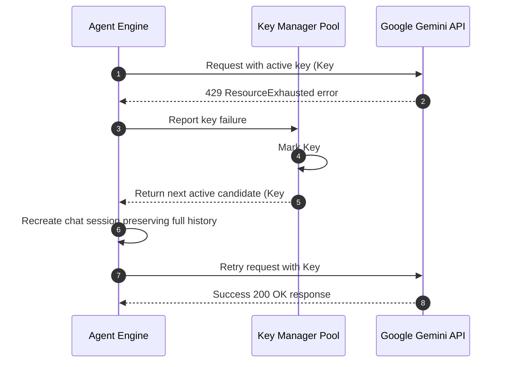

# API Key Pool, Auto-Failover & Quota Alerts 🔑⚠️

**English Version** | [نسخه فارسی](API-Key-Pool-and-Failover.fa.md)

A critical limitation of typical AI desktop applications is sudden interruption when an API key hits rate limits or monthly quotas. Nova Desktop AI Agent prevents downtime through an **autonomous API key pool with instant failover and 100% session history preservation**.

---

## 1. Zero-Loss Failover Mechanism

- **Operational Pipeline:**
  1. Users configure multiple Gemini API keys with custom labels in the Settings window.
  2. Upon encountering quota exhaustion errors (HTTP 429, QuotaExceeded, or ResourceExhausted), Nova flags the failed key and shifts to the next viable candidate in the queue.
  3. **Full History Preservation:** The previous chat turns are reconstructed inside the new client session; in-flight tasks and conversation context are completely preserved.

---

## 2. Five-Channel Proactive Quota Alert System

When an individual key is exhausted or pool capacity drops to low headroom, Nova triggers alerts across five distinct channels:

1. **🚨 Visual Mascot Alert:** Desktop pet pulses in amber/red warning luminescence.
2. **💬 Floating Desktop Bubble:** A floating comic bubble states: *«⚠️ Key quota depleted; migrating to backup key...»*.
3. **🔊 Audio Warning (TTS):** Synthesized speech announces the quota depletion through the speakers.
4. **🪧 In-Chat Alert Card:** A high-contrast warning card appears with an action button linking directly to Key Settings.
5. **🎈 Windows System Tray Balloon:** A system tray notification pops up near the taskbar clock even when the chat window is hidden.

---

## 3. Key Management in Settings

To manage API keys:
1. Click the gear icon (`⚙️`) in the chat window header.
2. Navigate to the **«🔑 کلیدها (API Pool)»** tab.
3. Paste your Gemini API key, assign a descriptive label (e.g. `Dev-Key`, `Backup-Key`), and click **«➕ افزودن کلید»**.
4. The status table provides real-time health indicators (Active, Depleted, Error) and allows manual key verification.

