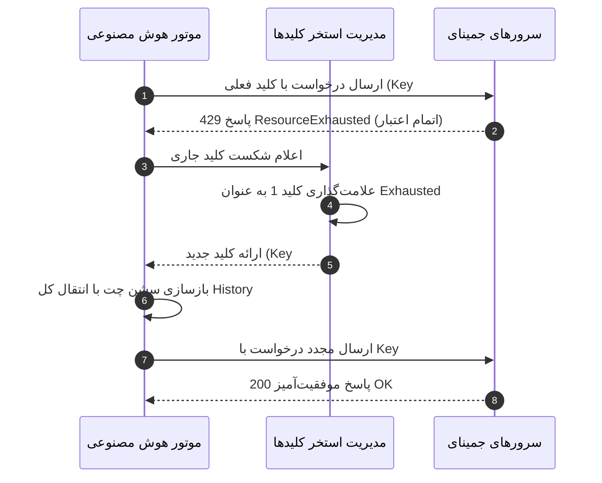

# استخر کلیدها، چرخش خودکار و هشدارهای اعتبار (API Key Pool & Failover) 🔑⚠️

[English Version](API-Key-Pool-and-Failover.en.md) | **نسخه فارسی**

یکی از نقاط ضعف چت‌بات‌های عادی، متوقف شدن برنامه به محض پایان سهمیه ماهانه یا محدودیت تعداد درخواست (Rate Limit) یک کلید API است. دستیار نوا برای حل این مشکل، دارای **استخر کلیدهای پویا با قابلیت چرخش خودکار و حفظ ۱۰۰٪ تاریخچه چت** است.

---

## ۱. چرخش خودکار بدون قطعی و بدون فراموشی (Zero-Loss Failover)

- **مکانیزم عملکرد:**
  1. کاربر می‌تواند چندین API Key جمینای را در پنجره تنظیمات با برچسب‌های مشخص تعریف کند.
  2. در صورت مواجهه با خطاهای اتمام سهمیه (مانند HTTP 429، Quota Exceeded یا Resource Exhausted)، سیستم به صورت خودکار کلید معیوب را علامت زده و به کلید فعال بعدی منتقل می‌شود.
  3. **حفظ کامل حافظه و تاریخچه:** کل پیام‌های رد و بدل شده در سشن قبلی به کلاینت جدید منتقل می‌شود؛ بنابراین دستیار به هیچ وجه کار در حال انجام یا گفتگوهای گذشته را فراموش نمی‌کند!

---

## ۲. سامانه ۵ کاناله هشدار کاهش اعتبار (Multi-Channel Alerts)

هنگامی که یک کلید به اتمام برسد یا تعداد کلیدهای سالم استخر به ۱ یا صفر کاهش یابد، سیستم بلافاصله از ۵ مسیر مختلف هشدار می‌دهد:

1. **🚨 هشدار بصری ربات دسکتاپ:** نورپردازی و چشمان کاراکتر به حالت اخطار قرمز/نارنجی تپنده درمی‌آید.
2. **💬 حباب گفتار شناور دسکتاپ:** پیامی روی صفحه ظاهر می‌شود: *«⚠️ اعتبار کلید تمام شد؛ انتقال به کلید پشتیبان...»*.
3. **🔊 اعلان صوتی گوینده (TTS):** گوینده ویندوز جمله *«هشدار: اعتبار کلید API به پایان رسید.»* را از اسپیکر پخش می‌کند.
4. **🪧 کارت بنر هشدار در پنجره چت:** یک کادر شیشه‌ای هشدار با حاشیه نئونی قرمز و دکمه دسترسی مستقیم به تنظیمات در چت نمایش می‌یابد.
5. **🎈 بالون اعلان ویندوز (System Tray):** در کنار ساعت ویندوز نوتیفیکیشن ظاهر می‌شود تا حتی اگر پنجره بسته بود، کاربر متوجه شود.

---

## ۳. مدیریت کلیدها در پنجره تنظیمات

برای اضافه یا حذف کردن کلیدها:
1. روی آیکون چرخ‌دنده (`⚙️`) در بالای پنجره چت کلیک کنید.
2. به تب **«🔑 کلیدها (API Pool)»** بروید.
3. کلید جدید خود را به همراه یک برچسب دلخواه (مثلاً `Personal Key` یا `Project Key`) وارد کرده و دکمه **«➕ افزودن کلید»** را بزنید.
4. جدول وضعیت لحظه‌ای هر کلید (فعال، استفاده‌شده، یا با خطا) را نمایش می‌دهد و امکان تست دستی کلیدها نیز وجود دارد.

