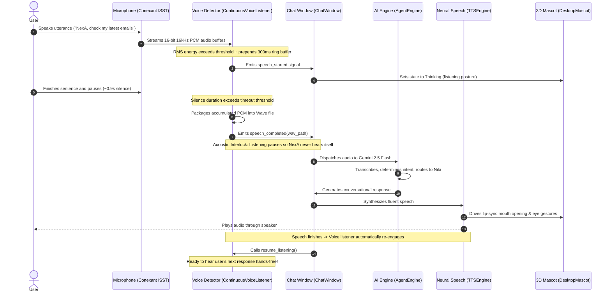
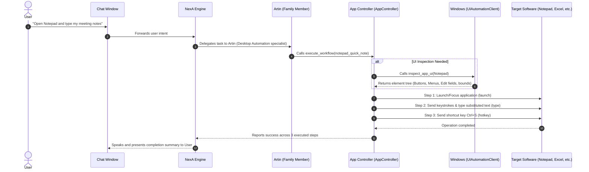

# System Architecture & Data Flow 🏛️

**English Version** | [نسخه فارسی](Architecture.fa.md)

This document describes the modular architecture, execution lifecycles, multi-agent family ecosystem, continuous hands-free voice activity detection (VAD), and desktop application automation of **NexA AI (نِکسا)**, engineered by **Rahkar Electronic Sahand** ([https://irres.ir](https://irres.ir)).

---

## 1. High-Level Layered Architecture

The system is separated into 5 decoupled architectural tiers:

```mermaid
graph TD
    subgraph UI_Layer [UI Presentation Layer - PyQt6]
        Mascot[DesktopMascot - 3D Expressive Pet with Volumetric Lip-Sync]
        Bubble[SpeechBubble - Floating Dialogue Card]
        Chat[ChatWindow - Glassmorphic Cyberpunk Command Center]
        Settings[SettingsWindow - 6-Tab Configuration Studio]
        Tray[SystemTray - Background Windows Tray Monitor]
    end

    subgraph Audio_Voice_Layer [Audio & Conversational VAD Tier]
        VAD[ContinuousVoiceListener - Real-time VAD & Wake-Word Detector]
        AudioRec[AudioRecorder - Manual Wave Recorder]
        TTS[TTSEngine - Gemini Neural Speech & SAPI Fallback]
    end

    subgraph Family_Ecosystem_Layer [Multi-Agent Family Ecosystem]
        FamMgr[FamilyManager - Task Router & Skill Inheritance Director]
        Artin[Artin - Windows UI & Macro Automation Specialist]
        Nila[Nila - Email & Public Relations Assistant]
        Tara[Tara - Visual Designer & Reels Strategist]
        SamYar[SamYar - Senior Software & QA Engineer]
        Parents[NexaMehr & NexaNoo - Architecture & Caregivers]
    end

    subgraph Core_Agent_Layer [Core AI & Cognitive Engine]
        Engine[AgentEngine - Gemini Session & Tools Dispatcher]
        KeyMgr[KeyManager - API Key Pool with Zero-Loss Failover]
        MemMgr[MemoryManager - Long-term Knowledge Base]
        LearnEng[LearningEngine - Autonomous Self-Learning Loop]
        MultiAI[MultiAiCollaborator - Peer Review & Offline LLMs]
        CfgMgr[ServicesConfigManager - Persistent System Configuration]
    end

    subgraph Automation_Integrations_Layer [Automation & System Layer]
        AppCtrl[AppController - Native Windows UI Automation & Macros]
        EmailSvc[EmailService - Secure IMAP/SMTP Client]
        SocialMgr[SocialMediaManager - Reels Studio & Instagram Browser Hooks]
        OSTools[PowerShell / Python / Files / Webcam / Vision / Diagnostics]
        WinOS[(Windows 10/11 & Hardware)]
    end

    Chat --> VAD
    VAD --> Chat
    Chat --> Engine
    Engine --> FamMgr
    FamMgr --> Artin
    FamMgr --> Nila
    FamMgr --> Tara
    FamMgr --> SamYar
    FamMgr --> Parents
    Artin --> AppCtrl
    Nila --> EmailSvc
    Tara --> SocialMgr
    Engine --> KeyMgr
    Engine --> MemMgr
    Engine --> LearnEng
    Engine --> MultiAI
    Engine --> CfgMgr
    Engine --> OSTools
    AppCtrl --> WinOS
    EmailSvc --> WinOS
    SocialMgr --> WinOS
    OSTools --> WinOS
    Engine --> Mascot
    Engine --> Bubble
    Engine --> TTS
    TTS --> Mascot
```

---

## 2. Hands-Free Conversational Lifecycle (VAD & Acoustic Interlock)

Natural human-to-human hands-free voice loop without requiring mouse clicks:

---

## 3. Universal Desktop App Automation & Macro Execution Flow

How NexA connects to Windows software controls and executes learned macros:

---

## 4. Module Responsibility Matrix

- **`main.py`**: Application bootstrap, signal routing, Windows dark/light mode detector, and accent color synchronization.
- **`agent/engine.py`**: Central coordinator, system prompt composition, key rotation management, and tool dispatcher.
- **`agent/voice_detector.py`**: Real-time continuous voice activity detection, dynamic noise tracking, silence timeout, and acoustic interlock.
- **`agent/family/manager.py`**: Family ecosystem director, prompt delegator, XP and level progression manager.
- **`agent/family/app_controller.py`**: Windows UI Automation client, control inspector, and macro workflow learner/executor.
- **`agent/integrations/email_client.py`**: Secure IMAP4 SSL / SMTP email client with priority categorization and auditory readout.
- **`agent/integrations/social_manager.py`**: Instagram viral Reels planner, caption and hashtag creator, and browser session launcher.
- **`agent/integrations/config_manager.py`**: Auto-detects host system defaults and persistently saves configurations in `data/integrations_config.json`.
- **`agent/key_manager.py`**: Gemini API key pool manager with zero-loss HTTP 429 failover.
- **`agent/memory.py`**: Persistent long-term memory store across restarts.
- **`agent/learning.py`**: Autonomous failure reflection engine synthesizing permanent corrective rules.
- **`agent/multi_ai.py`**: Peer AI collaborator interfacing with cloud LLMs (GPT-4o, Claude) and offline models (Ollama, LM Studio).
- **`agent/tts.py`**: Gemini Neural Speech synthesizer with offline Windows SAPI fallback.
- **`ui/mascot.py`**: Procedural vector renderer for 8 distinct 3D avatars, dynamic gaze tracking, and lip-sync.
- **`ui/chat_window.py`**: Cyberpunk glassmorphic chat interface with hands-free conversation button `🗣️`.
- **`ui/settings_window.py`**: 6-tab unified control center (Persona & Family, API Keys, Memory, Learning, Companion, Multi-AI).

