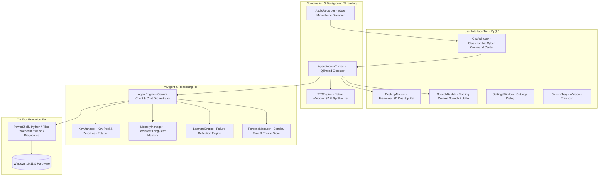
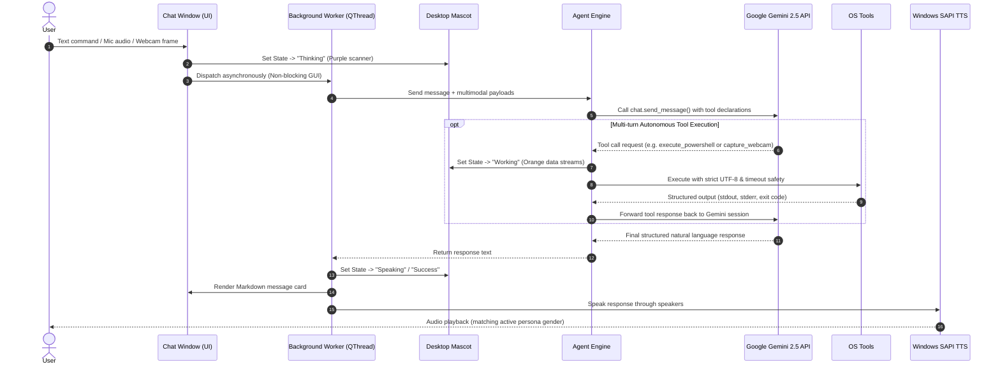

# System Architecture & Data Flow 🏛️

**English Version** | [نسخه فارسی](Architecture.fa.md)

This technical specification details the modular architecture, lifecycle workflows, threading model, and data interactions uniting PyQt6, Google Gemini 2.5 Flash, and the Windows OS execution layer in Nova Desktop AI Agent.

---

## 1. High-Level Layered Architecture

The system is decomposed into four discrete, decoupled tiers:

---

## 2. Request Lifecycle & Tool Execution Sequence

When a user submits a prompt, voice recording, or webcam snapshot, execution flows asynchronously through the pipeline:

---

## 3. Module Breakdown & Responsibility Matrix

- **`main.py`**: Application bootstrap, signal-slot choreography, window positioning, system tray setup.
- **`agent/engine.py`**: Gemini chat session management, prompt composition, failover retries, and tool routing.
- **`agent/tools.py`**: Isolated execution environments for PowerShell, Python subprocesses, filesystem I/O, OpenCV webcam capture, desktop screenshots, and system hardware telemetry.
- **`agent/key_manager.py`**: Thread-safe API key pool, persistent health state, automatic rotation upon quota exhaustion.
- **`agent/memory.py`**: Long-term persistent key-value memory store (`data/memory.json`), semantic queries, system prompt injection.
- **`agent/learning.py`**: Automated failure reflection, corrective rule formulation, and gold-rule injection (`data/learnings.json`).
- **`agent/audio_recorder.py`**: Uncompressed Wave audio recording from the default Windows microphone device.
- **`agent/tts.py`**: SAPI speech synthesis with non-blocking async speech and dynamic voice matching (David/Zira).
- **`ui/mascot.py`**: Volumetric 3D vector rendering without raster image assets, supporting 4 avatars, physics float, and reactive emotional visors.
- **`ui/chat_window.py`**: Glassmorphic UI with quick action chips, multimedia attachment bar, markdown code cards, and alert banners.
- **`ui/settings_window.py`**: Tabbed dialog for keys pool, memory inspection, learning engine records, voice testing, and 3D avatar selection.

