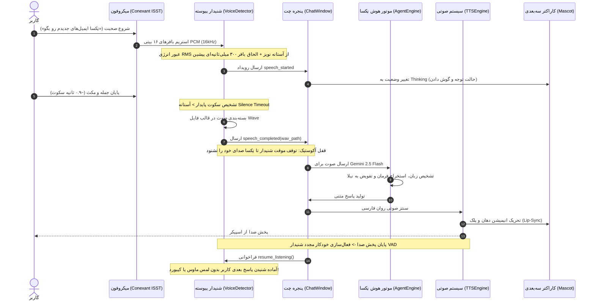
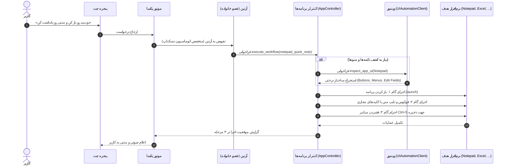

# معماری و جریان داده سیستم (System Architecture) 🏛️

[English Version](Architecture.en.md) | **نسخه فارسی**

این مستند تشریح‌کننده معماری ماژولار، چرخه حیات درخواست‌ها، اکوسیستم چندعاملی خانواده، پردازش صوتی پیوسته (VAD) و اتوماسیون دسکتاپ در پروژه دستیار هوشمند **«نِکسا» (NexA AI)** محصول شرکت **راهکار الکترونیک سهند** ([irres.ir](https://irres.ir)) است.

---

## ۱. نمای کلی لایه‌های سیستم (Layered Architecture)

سیستم به ۵ لایه اصلی و مستقل تفکیک شده است:

```mermaid
graph TD
    subgraph UI_Layer [لایه رابط کاربری - PyQt6]
        Mascot[DesktopMascot - شکلک ۳بعدی با میمیک و لب‌خوانی]
        Bubble[SpeechBubble - حباب گفتار شناور]
        Chat[ChatWindow - مرکز فرمان و چت شیشه‌ای با دکمه مکالمه پیوسته]
        Settings[SettingsWindow - پنجره ۶ تبی تنظیمات]
        Tray[SystemTray - آیکون سیستم‌تری ویندوز]
    end

    subgraph Audio_Voice_Layer [لایه صوت، شنیدار و مکالمه پیوسته]
        VAD[ContinuousVoiceListener - شنیدار پیوسته VAD و بیدارباش]
        AudioRec[AudioRecorder - ضبط دستی صوت Wave]
        TTS[TTSEngine - سنتز صوتی عصبی Gemini Neural TTS / SAPI]
    end

    subgraph Family_Ecosystem_Layer [لایه زیست‌بوم خانواده چندعاملی]
        FamMgr[FamilyManager - مسیریاب و مدیر ارث‌بری مهارت‌ها]
        Artin[آرتین - اپراتور اتوماسیون دسکتاپ و ماکروها]
        Nila[نیلا - دستیار ایمیل و روابط عمومی]
        Tara[تارا - طراح گرافیک و استراتژیست ریلز]
        SamYar[سامیار - مهندس نرم‌افزار و باگ‌یابی کد]
        Parents[نکسامهر و نکسانو - معماری سیستم و مربیگری]
    end

    subgraph Core_Agent_Layer [لایه هسته هوش مصنوعی و یادگیری]
        Engine[AgentEngine - مدیریت سشن جمینای و ابزارها]
        KeyMgr[KeyManager - استخر کلیدها و چرخش بدون قطعی]
        MemMgr[MemoryManager - حافظه بلندمدت دائمی]
        LearnEng[LearningEngine - موتور خودآموزی از خطاها]
        MultiAI[MultiAiCollaborator - همکاری با هوش‌های همکار/محلی]
        CfgMgr[ServicesConfigManager - تنظیمات پایدار سیستم]
    end

    subgraph Automation_Integrations_Layer [لایه اتوماسیون و سرویس‌های خارجی]
        AppCtrl[AppController - کنترل UI Automation و ماکروها]
        EmailSvc[EmailService - کلاینت امن IMAP/SMTP ایمیل]
        SocialMgr[SocialMediaManager - استودیو سناریونویسی و مرورگر اینستاگرام]
        OSTools[PowerShell / Python / Files / Webcam / Vision / Diagnostics]
        WinOS[(ویندوز ۱۰ و ۱۱ / سخت‌افزار)]
    end

    Chat --> VAD
    VAD --> Chat
    Chat --> Engine
    Engine --> FamMgr
    FamMgr --> Artin
    FamMgr --> Nila
    FamMgr --> Tara
    FamMgr --> SamYar
    FamMgr --> Parents
    Artin --> AppCtrl
    Nila --> EmailSvc
    Tara --> SocialMgr
    Engine --> KeyMgr
    Engine --> MemMgr
    Engine --> LearnEng
    Engine --> MultiAI
    Engine --> CfgMgr
    Engine --> OSTools
    AppCtrl --> WinOS
    EmailSvc --> WinOS
    SocialMgr --> WinOS
    OSTools --> WinOS
    Engine --> Mascot
    Engine --> Bubble
    Engine --> TTS
    TTS --> Mascot
```

---

## ۲. چرخه حیات مکالمه صوتی پیوسته (Hands-free VAD Lifecycle)

گردش کار مکالمه آزاد انسان با انسان بدون فشردن دکمه:

---

## ۳. چرخه کشف کنترل‌ها و اتوماسیون نرم‌افزارها (Universal App Automation Flow)

نحوه اتصال به نرم‌افزارهای دسکتاپ و اجرای فرآیندهای یادگرفته‌شده:

---

## ۴. ماتریس مسئولیت ماژول‌های پروژه

- **`main.py`**: نقطه ورود اصلی، اتصال سیگنال‌های رابط کاربری، همگام‌ساز تم تاریک/روشن و رنگ شاخص ویندوز.
- **`agent/engine.py`**: موتور هماهنگ‌کننده کلان، تزریق پرامپت شخصیت فعال، چرخش کلیدها و دیکشنری ابزارها.
- **`agent/voice_detector.py`**: ماژول شنیدار پیوسته (ContinuousVoiceListener)، محاسبه لحظه‌ای RMS انرژی، فیلتر نویز، تشخیص مکث و قفل آکوستیک.
- **`agent/family/manager.py`**: مدیر اکوسیستم خانواده نِکسا، مسیریابی هوشمند پرامپت‌ها بر اساس تخصص، سیستم ترفیع و XP اعضا.
- **`agent/family/app_controller.py`**: اتصال بومی به تمام نرم‌افزارهای ویندوز از طریق `UIAutomationClient`، یادگیری و اجرای ماکروها.
- **`agent/integrations/email_client.py`**: کلاینت ایمیل IMAP4 SSL و SMTP با تفکیک ایمیل‌های مهم و بازگویی خلاصه صوتی.
- **`agent/integrations/social_manager.py`**: طراح سناریوی ریلزهای اینستاگرام، نگارش کپشن و هشتگ، و کنترل مرورگر.
- **`agent/integrations/config_manager.py`**: شناسایی هوشمند پیش‌فرض‌های سیستم و ذخیره پایدار در `data/integrations_config.json`.
- **`agent/key_manager.py`**: مدیریت استخر کلیدهای Gemini با چرخش بدون قطعی در صورت خطای ۴۲۹.
- **`agent/memory.py`**: پایگاه حافظه بلندمدت دائمی در قالب JSON.
- **`agent/learning.py`**: تحلیل خطاها و استخراج قوانین طلایی برای جلوگیری همیشگی از تکرار اشتباه.
- **`agent/multi_ai.py`**: پل ارتباطی با سایر هوش‌های ابری (GPT-4o, Claude) و محلی کاملاً آفلاین (Ollama, LM Studio).
- **`agent/tts.py`**: گوینده هوشمند صوتی فارسی Gemini Neural TTS با فال‌بک آفلاین SAPI.
- **`ui/mascot.py`**: موتور رندر ۸ کاراکتر سه‌بعدی، لب‌خوانی برداری هماهنگ با صدا و انیمیشن‌های احساسی.
- **`ui/chat_window.py`**: پنجره شیشه‌ای چت، دکمه مکالمه پیوسته `🗣️`، کارت‌های ابزار و ویجت‌های مالتی‌مدیا.
- **`ui/settings_window.py`**: پنل جامع ۶ تبی تنظیمات (شخصیت و خانواده، کلیدها، حافظه، یادگیری، همراهی، هوش‌های همکار).

