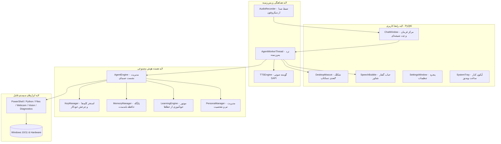
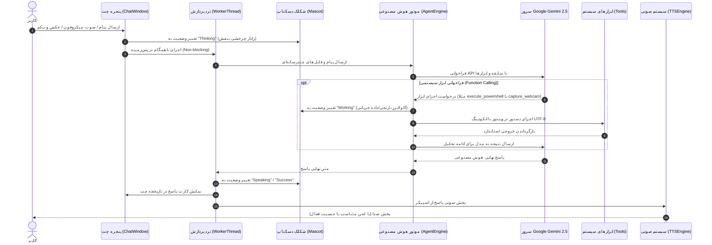

# معماری و جریان داده سیستم (System Architecture) 🏛️

[English Version](Architecture.en.md) | **نسخه فارسی**

این مستند تشریح‌کننده معماری ماژولار، چرخه حیات درخواست‌ها، نحوه هماهنگی بین رابط کاربری PyQt6، موتور هوش مصنوعی Gemini 2.5 Flash و ابزارهای سیستم‌عامل در پروژه دستیار هوشمند نوا است.

---

## ۱. نمای کلی لایه‌های سیستم (Layered Architecture)

سیستم به ۴ لایه اصلی و مستقل تفکیک شده است:

---

## ۲. چرخه حیات ارسال پیام و فراخوانی ابزار (Interaction Flow)

هنگامی که کاربر پیامی صوتی، تصویری یا متنی ارسال می‌کند، گردش کار مطابق دیاگرام توالی زیر اجرا می‌گردد:

---

## ۳. تفکیک مسئولیت‌های ماژول‌ها (Module Matrix)

- **`main.py`**: نقطه ورود برنامه، اتصال سیگنال‌های PyQt6، تنظیم موقعیت اولیه پنجره‌ها و مدیریت Tray Icon.
- **`agent/engine.py`**: مدیریت سشن چت جمینای، تلفیق پرامپت‌ها، مدیریت چرخش کلیدها و دیکشنری ابزارها.
- **`agent/tools.py`**: پیاده‌سازی امن توابع پاورشل، اجرای کد پایتون، عملیات دیسک، وب‌کم OpenCV، اسکرین‌شات Pillow و سلامت سیستم.
- **`agent/key_manager.py`**: استخر کلیدهای API، مدیریت سهمیه، نرخ مصرف و چرخش بدون فراموشی تاریخچه.
- **`agent/memory.py`**: مدیریت پایگاه دانش بلندمدت محلی در قالب JSON، جستجوی کلیدواژه‌ای و تزریق پویا به سیستم‌پرامپت.
- **`agent/learning.py`**: موتور بازتاب بر خطاهای اجرا، استخراج قوانین اصلاحی و تضمین عدم تکرار اشتباهات گذشته.
- **`agent/audio_recorder.py`**: رکورد صوت بافر بدون افت فشرده‌سازی با فرمت Wave از طریق `QMediaCaptureSession`.
- **`agent/tts.py`**: سنتز گفتار محلی با رابط `win32com` و پشتیبانی از گوینده‌های David و Zira.
- **`ui/mascot.py`**: رندر برداری سه‌بعدی بدون استفاده از تصاویر سنگین، پشتیبانی از ۴ سبک کاراکتر، شناوری و حالات حسی.
- **`ui/chat_window.py`**: مرکز کنترل شیشه‌ای دارک، چیپ‌های دسترسی سریع، ویجت‌های کارت پاسخ و ابزارهای مالتی‌مدیا.
- **`ui/settings_window.py`**: مدیریت تنظیمات کلیدها، ویرایش حافظه، پایش خودآموزی و انتخاب استایل کاراکتر.

