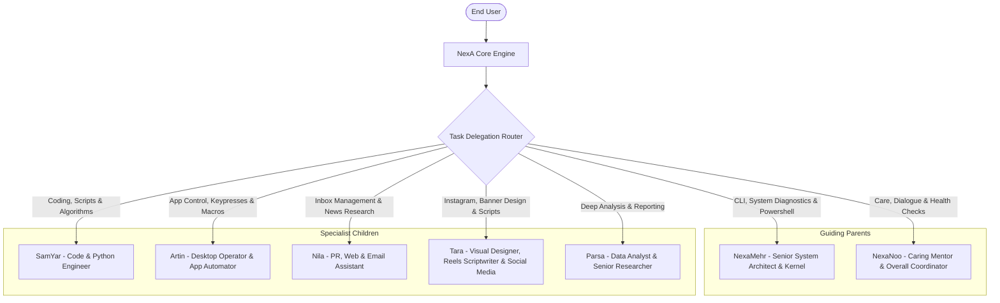

<div lang="en" dir="ltr" align="left">

# AI Family Ecosystem & Desktop App Automation 👨‍👩‍👧‍👦🖥️

[نسخه فارسی](Family-Ecosystem-and-App-Automation.fa.md) | **English Version**

This documentation chapter details two major innovations in the **NexA AI** Desktop Agent by **Rahkar Electronic Sahand** ([irres.ir](https://irres.ir)): the multi-agent family ecosystem and the universal Windows UI automation engine.

---

## 1. NexA Multi-Agent Family Structure

Instead of a monolithic generic AI, NexA operates through a cohesive specialized family structure:



### Family Member Profiles:
1. **NexaMehr:** The father figure; oversees system hardware, PowerShell execution, RAM/CPU diagnostics, and process integrity.
2. **NexaNoo:** The mother figure; attentive listener, mentor, health monitor, and family cohesion coordinator.
3. **SamYar:** The eldest son; lead software engineer proficient in Python, C#, testing, and architectural debugging.
4. **Artin:** The desktop specialist son; operates running Windows applications, triggers shortcuts, and executes automation macros.
5. **Nila:** The communications specialist daughter; triages incoming emails, filters financial alerts, and recites spoken summaries.
6. **Tara:** The creative designer daughter; plans Instagram reels, visual banners, and generates engaging viral captions.
7. **Parsa:** The analytical son; handles complex data analysis, comparisons, and structured report synthesis.

---

## 2. Member Customization & Skill Learning

Users can inspect and customize all aspects of family members or register new ones:

* **Settings Form in Tab 0 (`ui/settings_window.py`):**
  * Persian and English display names.
  * Gender setting (Male / Female) with automatic TTS voice speaker pairing.
  * Mood calibration: intimate (`intimate`), witty (`witty`), technical (`technical`), caring (`caring`), energetic (`energetic`), etc.
  * 3D Avatar style and job title assignment.
* **Conversational AI Tool Interface:**
  * `switch_family_member(member_name)`: Switches the currently active agent persona.
  * `customize_family_member(...)`: Dynamically alters member attributes via voice or text prompts.
  * `teach_family_skill(member_name, skill_name, steps)`: Teaches a step-by-step workflow to a member, rewarding experience points (XP).
  * `add_family_member(...)`: Registers a brand-new custom family member.

---

## 3. Universal Desktop App Automation (`AppController`)

The `agent/family/app_controller.py` module leverages native **Windows UI Automation** without requiring heavy third-party drivers:

### Window UI Inspection (`inspect_app_ui`):
NexA traverses the control hierarchy of targeted windows to discover:
* Buttons (`Button`)
* Text inputs (`Edit`)
* Menu items (`MenuItem`)
* Tabs (`TabItem`)
* Checkboxes (`CheckBox`) along with pixel coordinates (`BoundingRectangle`) and system `AutomationId`s.

### Direct Invocation and Clicking (`invoke_app_element`):
Invokes native Windows automation patterns (`InvokePattern`, `TogglePattern`) to execute clicks and trigger controls seamlessly.

---

## 4. Macro Workflow Learning Engine

NexA memorizes and replicates multi-step desktop workflows:

* **Record Workflow (`learn_app_workflow`):**
  Persists sequences of launching apps, typing text, key combinations, and clicks in [data/app_workflows.json](file:///c:/Users/Taimazus/Desktop/MyAgent/data/app_workflows.json).
* **Automated Execution with Variable Substitution (`execute_app_workflow`):**
  Replays workflow steps while dynamically injecting user arguments (such as `{text}` or `{filename}`).

---

## 5. Automated Verification
All family member and desktop automation capabilities are verified by automated test suites:
```powershell
python -m pytest tests/test_family.py tests/test_app_control.py -v
```

</div>
