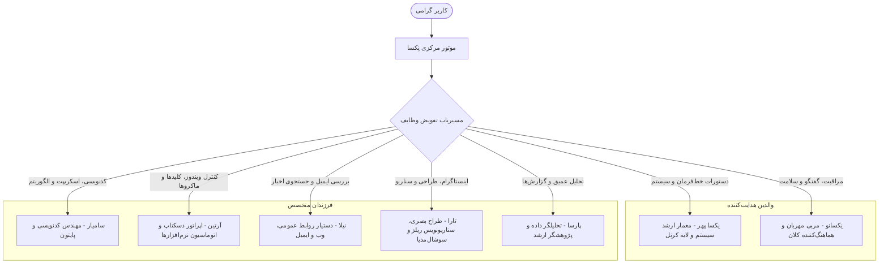

<div lang="fa" dir="rtl" align="right">

# اکوسیستم خانواده هوش مصنوعی و اتوماسیون نرم‌افزارها (Family Ecosystem & App Automation) 👨‍👩‍👧‍👦🖥️

[English Version](Family-Ecosystem-and-App-Automation.en.md) | **نسخه فارسی**

این بخش از دانشنامه اختصاص به دو نوآوری برجسته در دستیار هوشمند **«نِکسا» (NexA AI)** محصول شرکت **راهکار الکترونیک سهند** ([irres.ir](https://irres.ir)) دارد: ساختار خانواده چندعاملی و موتور کنترل فراگیر نرم‌افزارهای دسکتاپ.

---

## ۱. ساختار زیست‌بوم خانواده نِکسا (NexA Multi-Agent Family)

به جای یک هوش مصنوعی تک‌بعدی، نِکسا دارای ساختار تیمی شبیه به یک خانواده تخصصی و هم‌افزا است:



### مشخصات اعضای خانواده:
1. **نِکسامِهر (NexaMehr):** پدر خانواده، متخصص نظارت بر سخت‌افزار، اسکریپت‌های PowerShell، حافظه رم و پردازنده.
2. **نِکسانو (NexaNoo):** مادر خانواده، شنونده صمیمی، مربی اعضا، ناظر سلامت و تنظیم‌کننده روابط خانوادگی.
3. **سامیار (SamYar):** فرزند ارشد، مهندس ارشد نرم‌افزار، مسلط به زبان‌های پایتون، سی‌شارپ، تست و رفع باگ‌ها.
4. **آرتین (Artin):** فرزند متخصص دسکتاپ، مسلط به کنترل تمامی نرم‌افزارهای باز ویندوز، کلیدهای میانبر و اجرای ماکروها.
5. **نیلا (Nila):** فرزند متخصص ارتباطات، مسئول صندوق ایمیل‌ها، دسته‌بندی پیام‌های مالی و بازگویی خلاصه‌ها.
6. **تارا (Tara):** فرزند خلاق و طراح، متخصص سوشال‌مدیا، سناریونویسی ویدیوهای ریلز اینستاگرام و تولید کپشن‌های جذاب.

---

## ۲. شخصی‌سازی و آموزش مهارت به فرزندان (Customization & Skill Learning)

کاربر می‌تواند تمامی خصوصیات اعضای خانواده را تغییر داده یا عضو جدیدی ایجاد کند:

* **فرم شخصی‌سازی در تب ۰ تنظیمات (`ui/settings_window.py`):**
  * تغییر نام فارسی و انگلیسی عضو
  * تعیین جنسیت (آقا / خانم) و تطبیق خودکار گوینده صوتی
  * تنظیم حس‌وحال (Mood): صمیمی (`intimate`)، شوخ‌طبع (`witty`)، فنی (`technical`)، مراقب (`caring`)، انگیزه‌بخش (`energetic`) و...
  * انتخاب استایل آواتار ۳ بعدی و عنوان شغلی
* **ابزارهای هوش مصنوعی جهت تغییر از طریق گفتگو:**
  * `switch_family_member(member_name)`: تغییر عضو فعال
  * `customize_family_member(...)`: شخصی‌سازی مشخصات با فرمان صوتی
  * `teach_family_skill(member_name, skill_name, steps)`: آموزش فرآیند جدید به فرزندان با افزایش امتیاز تجربه (XP)
  * `add_family_member(...)`: ایجاد عضو تخصصی جدید

---

## ۳. اتوماسیون فراگیر نرم‌افزارهای دسکتاپ (`AppController`)

ماژول `agent/family/app_controller.py` بدون نیاز به نصب کتابخانه‌های سنگین خارجی و با استفاده از رابط بومی **Windows UI Automation** امکان تعامل با تمامی نرم‌افزارها را فراهم می‌کند:

### کشف و بازرسی المان‌های پنجره (`inspect_app_ui`):
نِکسا درخت کنترلی هر پنجره را کاوش کرده و تمامی موارد زیر را استخراج می‌کند:
* دکمه‌ها (`Button`)
* کادرهای متنی (`Edit`)
* گزینه‌های منو (`MenuItem`)
* زبانه‌ها (`TabItem`)
* چک‌باکس‌ها (`CheckBox`) همراه با مختصات پیکسلی (`BoundingRectangle`) و شناسه‌های سیستمی (`AutomationId`).

### کلیک و فراخوانی مستقیم (`invoke_app_element`):
با اجرای الگوی بومی `InvokePattern` یا `TogglePattern` در ویندوز، المان‌های نرم‌افزار هدف بدون دخالت دست کلیک می‌شوند.

---

## ۴. یادگیری خودکار گردش‌کار و ماکروها (Macro Learning Engine)

نِکسا توانایی به‌خاطرسپاری فرآیندهای کاری چندمرحله‌ای را دارد:

* **ثبت فرآیند (`learn_app_workflow`):**
  ذخیره گام‌های باز کردن برنامه، تایپ متن، فشردن میانبرها و کلیک‌ها در [data/app_workflows.json](file:///c:/Users/Taimazus/Desktop/MyAgent/data/app_workflows.json).
* **اجرای خودکار با جایگزینی متغیرها (`execute_app_workflow`):**
  اجرای توالی مراحل با امکان تزریق پارامترهای پویا مانند نام فایل، عنوان گزارش یا متن پیام (مانند `{text}` یا `{filename}`).

---

## ۵. تست‌های تضمین کیفیت
تمامی قابلیت‌های خانواده و اتوماسیون نرم‌افزارها تحت پوشش تست‌های خودکار هستند:
```powershell
python -m pytest tests/test_family.py tests/test_app_control.py -v
```

</div>
