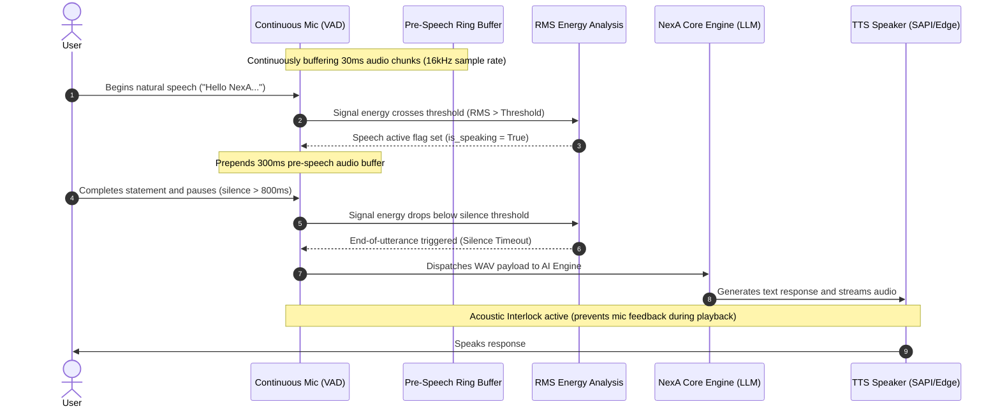

<div lang="en" dir="ltr" align="left">

# Integrations, Email Client, Instagram Studio & Continuous Voice VAD 🎙️📧📱

[نسخه فارسی](Integrations-and-Voice-VAD.fa.md) | **English Version**

This documentation chapter outlines the communication and voice intelligence features of the **NexA AI** Desktop Agent by **Rahkar Electronic Sahand** ([irres.ir](https://irres.ir)), including hands-free Voice Activity Detection (VAD), full email client integration (IMAP/SMTP), and the Instagram content creation studio.

---

## 1. Continuous Voice Activity Detection Architecture (Hands-free VAD)

In the latest release of NexA, users do not need to manually trigger or stop microphone recording. The `agent/voice_detector.py` module uses `ContinuousVoiceListener` to monitor ambient audio in real time asynchronously:



### Key Capabilities of the VAD System:
1. **Pre-Speech Ring Buffer:** Preserves the preceding 300ms of audio, ensuring initial consonants and syllables are never cut off.
2. **Intelligent Silence Timeout:** Once speech pauses for a configurable duration (500ms to 1000ms), recording finalizes and automatically routes to the model.
3. **Acoustic Interlock:** While NexA is outputting synthesized voice via TTS or audio players, microphone capture is temporarily gated to eliminate acoustic feedback loops.
4. **Wake-Word Mode:** Supports both free-form continuous dialogue and wake-word gated activation ("NexA" / "Salam NexA").

---

## 2. Email Management Client (IMAP & SMTP)

The `agent/integrations/email_client.py` module establishes secure connections to email servers (Gmail, Yahoo, Outlook, or private corporate mail servers):

### AI Tool Interface:
* `check_emails(folder="INBOX", limit=5, unread_only=True, search_query="")`: Retrieves headers, sender information, subject lines, and synthesized message summaries.
* `send_email(to_email, subject, body)`: Sends formatted emails or drafts automated replies via SMTP.
* `configure_email_settings(imap_server, imap_port, smtp_server, smtp_port, email_address, ...)`: Updates connection credentials dynamically.

### Intelligent Prioritization & Audio Briefings:
NexA categorizes messages based on urgency, invoices/financial topics, and projects, delivering concise spoken briefings directly to the user.

---

## 3. Instagram Content Creator & Reels Studio

Powered by `agent/integrations/instagram_studio.py` and the creative persona "Tara", NexA automates social media workflows:

### AI Tool Interface:
* `plan_instagram_content(topic, target_audience, content_type)`: Generates detailed 30-to-60-second video reel scripts, hook suggestions, call-to-actions (CTA), and viral hashtags.
* `open_instagram()`: Launches the Instagram web interface in the default browser.
* `copy_caption_to_clipboard(caption)`: Automatically places generated captions and hashtags on the Windows clipboard for one-click publishing.

---

## 4. Settings Configuration UI

Dedicated configuration tabs are provided in `ui/settings_window.py` for:
* Mail server endpoints, ports, SSL/TLS toggles, and credentials.
* Microphone RMS sensitivity thresholds, silence timeouts, and wake-word toggles.
* Instagram defaults and handle settings.

Configurations are safely stored in [data/integrations_config.json](file:///c:/Users/Taimazus/Desktop/MyAgent/data/integrations_config.json).

---

## 5. Automated Verification
The integrations and voice activity detector are validated with automated unit tests:
```powershell
python -m pytest tests/test_integrations.py tests/test_voice_detector.py -v
```

</div>
