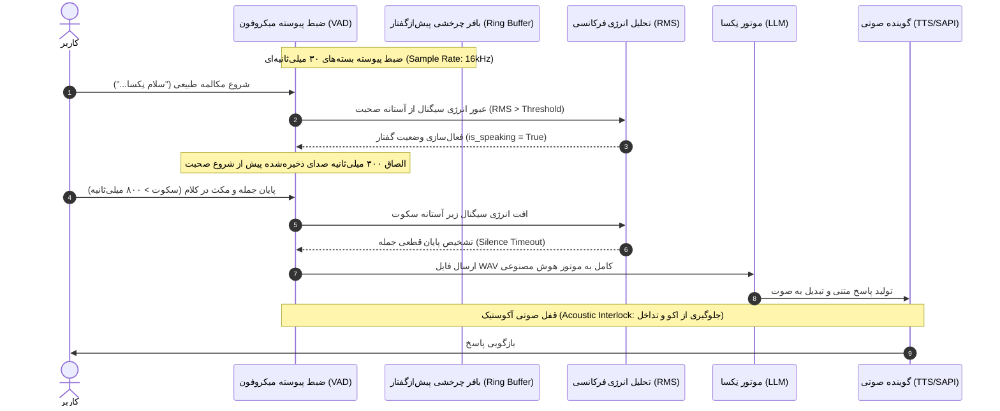

<div lang="fa" dir="rtl" align="right">

# یکپارچه‌سازی‌ها، صندوق ایمیل، استودیوی اینستاگرام و تعامل صوتی پیوسته (VAD) 🎙️📧📱

[English Version](Integrations-and-Voice-VAD.en.md) | **نسخه فارسی**

این مستند تشریح‌کننده قابلیت‌های پیشرفته چندرسانه‌ای و ارتباطی دستیار **«نِکسا» (NexA AI)** محصول شرکت **راهکار الکترونیک سهند** ([irres.ir](https://irres.ir)) شامل تعامل صوتی کاملاً بی‌نیاز از دست (Hands-free Voice Activity Detection)، ماژول مدیریت صندوق ایمیل (IMAP/SMTP)، و استودیوی تولید محتوای اینستاگرام است.

---

## ۱. معماری تعامل صوتی پیوسته و هوشمند (Continuous VAD Engine)

در نسخه جدید نِکسا، کاربر نیازی به کلیک بر روی دکمه ضبط میکروفون یا متوقف کردن دستی آن ندارد. ماژول `agent/voice_detector.py` با بهره‌گیری از کلاس `ContinuousVoiceListener` صدای محیط را به صورت غیرهمزمان و بلادرنگ مانیتور می‌کند:



### ویژگی‌های کلیدی موتور تشخیص صدا:
1. **بافر چرخشی پیش‌ازگفتار (Pre-Speech Buffer):** با نگهداری ۳۰۰ میلی‌ثانیه از صدای قبل از رسیدن انرژی به آستانه، از بریده شدن حروف ابتدای کلمات جلوگیری می‌کند.
2. **تشخیص هوشمند سکوت (Silence Detection):** پس از اتمام صحبت کاربر، با تشخیص سکوت پایدار (قابل تنظیم بین ۵۰۰ تا ۱۰۰۰ میلی‌ثانیه)، ضبط را بسته و مستقیماً برای پردازش ارسال می‌کند.
3. **قفل آکوستیک (Acoustic Interlock):** در حین پخش صدای پاسخ توسط نِکسا، شنود میکروفون موقتاً ایزوله شده تا صدای بلندگوی سیستم باعث بازخورد ناخواسته (Feedback Loop) نشود.
4. **حالت کلمه کلیدی بیدارباش (Wake-Word Mode):** امکان سوئیچ بین مکالمه آزاد پیوسته یا فعال‌سازی فقط با گفتن عبارت‌های بیدارباش مانند «نِکسا» یا «سلام نِکسا».

---

## ۲. ماژول مدیریت ایمیل (Email Management Client)

ماژول `agent/integrations/email_client.py` اتصال ایمن به ارائه‌دهندگان ایمیل (Gmail, Yahoo, Outlook یا میل‌سرورهای شرکتی) را از طریق پروتکل‌های استاندارد فراهم می‌کند:

### ابزارهای هوش مصنوعی ایمیل:
* `check_emails(folder="INBOX", limit=5, unread_only=True, search_query="")`: دریافت فهرست ایمیل‌ها، نام فرستنده، موضوع و خلاصه پیام.
* `send_email(to_email, subject, body)`: ارسال ایمیل رسمی یا پاسخ‌دهی خودکار از طریق SMTP.
* `configure_email_settings(imap_server, imap_port, smtp_server, smtp_port, email_address, ...)`: پیکربندی خودکار تنظیمات با فرمان صوتی.

### پالایش و گزارش صوتی:
نِکسا ایمیل‌های دریافتی را بر اساس اهمیت، کلمات کلیدی مالی (مانند فاکتور، پرداخت، قرارداد) یا فوریت اولویت‌بندی کرده و خلاصه‌ای موجز را برای کاربر بازگو می‌کند.

---

## ۳. استودیوی تولید محتوای اینستاگرام (Instagram Studio)

ماژول `agent/integrations/instagram_studio.py` و ایجنت تخصصی «تارا» فرآیند سناریونویسی و بازاریابی شبکه‌های اجتماعی را خودکار می‌سازند:

### ابزارهای هوش مصنوعی اینستاگرام:
* `plan_instagram_content(topic, target_audience, content_type)`: طراحی کامل سناریوی ۳۰ تا ۶۰ ثانیه‌ای برای ریلز، ساختار قلاب جلب توجه (Hook)، فراخوان اقدام (CTA)، و هشتگ‌های پربازدید.
* `open_instagram()`: باز کردن خودکار صفحه وب اینستاگرام در مرورگر سیستم کاربر.
* `copy_caption_to_clipboard(caption)`: کپی فوری متن کپشن و هشتگ‌ها در کلیپ‌بورد ویندوز جهت انتشار آسان.

---

## ۴. رابط کاربری تنظیمات یکپارچه‌سازی

در پنجره تنظیمات نِکسا (`ui/settings_window.py`)، زبانه‌های اختصاصی برای موارد زیر پیاده‌سازی شده است:
* پیکربندی مشخصات میل‌سرور و فعال‌سازی SSL/TLS.
* تنظیم حساسیت میکروفون، مدت زمان سکوت و انتخاب بین حالت بیدارباش یا گفتگوی پیوسته.
* نام کاربری اینستاگرام و سبک پیش‌فرض تولید محتوا.

تمام مقادیر در [data/integrations_config.json](file:///c:/Users/Taimazus/Desktop/MyAgent/data/integrations_config.json) به صورت امن نگهداری می‌شوند.

---

## ۵. تست و ارزیابی عملکرد
برای اجرای تست‌های تضمین کیفیت این ماژول‌ها:
```powershell
python -m pytest tests/test_integrations.py tests/test_voice_detector.py -v
```

</div>
